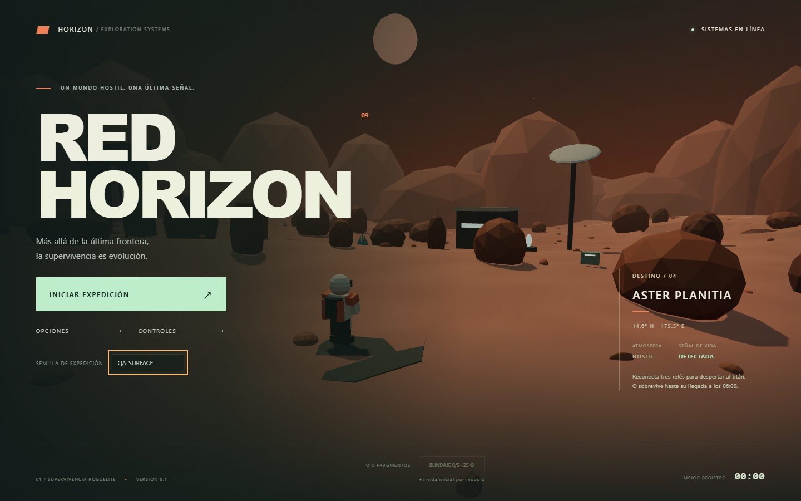

# RED HORIZON

Roguelite 3D de supervivencia en tercera persona, construido con JavaScript, Three.js y Vite. Personaje con esqueleto exportado desde Player.blend, movimientos procedurales y sonido sintetizado. Los recursos se sirven junto con el juego.



## Ejecutar

Requiere Node.js 22.12 o superior y un navegador de escritorio con WebGL2 y aceleración gráfica.

```sh
npm install
npm run dev
```

Abre la dirección local que imprime Vite (normalmente http://127.0.0.1:5173). El servidor de desarrollo escucha solamente en localhost. El despliegue de producción en EC2 y la configuración de red se describen en [Despliegue](docs/DEPLOYMENT.md).

```sh
npm run check       # ESLint, Vitest y compilación de producción
npx playwright install chromium
npm run test:e2e    # Pruebas funcionales; inicia Vite si hace falta
npm run build
npm run preview    # Comprobar dist localmente
```

## La expedición

Sobrevive en Aster Planitia. Elimina criaturas para obtener experiencia y elige uno de tres módulos cada vez que subes de nivel. Hay 15 mejoras acumulables, cuatro rarezas y tres armas disponibles desde el inicio.

Eres el último soldado de Aster. Activa los cinco altares con E para invocar a sus jefes; derrótalos, recoge sus cinco gemas y vuelve a la baliza blanca junto al punto de partida (0, 7). Pulsa **E** para insertarlas y lanzar la señal hacia la nave nodriza Aurora. Comienza una cuenta atrás de **60 segundos** hasta la extinción global, seguida de un epílogo original de 24 segundos realizado en el motor del juego. Morir antes del lanzamiento fracasa; morir después no cancela la señal. Pausa detiene tanto el reloj como la cinemática. Los relés y suministros siguen ofreciendo apoyo.

Los fragmentos obtenidos al finalizar se guardan localmente. En el menú puedes invertirlos en hasta cinco módulos de blindaje permanente (+5 de vida inicial cada uno). No hay cuentas, servidor ni compras. Abandonar desde pausa no deposita fragmentos.

## Controles

| Entrada | Acción |
|---|---|
| WASD | Movimiento relativo a la cámara |
| Ratón | Girar cámara después de capturarlo con clic |
| Shift izquierdo | Correr |
| Espacio | Saltar; mantener para encadenar bunnyhop al aterrizar |
| Ctrl izquierdo | Deslizarse con velocidad; Espacio cancela el deslizamiento con un salto |
| Clic izquierdo | Disparar; captura el ratón |
| Clic derecho | Apuntar con cámara cercana |
| 1 / 2 / 3 | Plasma / escopeta / lanzador explosivo |
| Q | Pulso de daño, aturdimiento y escudo temporal |
| E | Interactuar / insertar gemas y lanzar baliza |
| F | Alternar disparo continuo hacia la mira |
| Escape | Pausar, continuar y liberar el ratón |

Opciones: abre la pestaña Controles para reasignar acciones a teclas o botones del ratón. Las asignaciones ocupadas se intercambian; Esc cancela la captura y queda reservado para pausar. Puedes restaurar los controles originales. Se guardan localmente.

Otros ajustes: volumen, sensibilidad, distancia de cámara, calidad alta/baja y asistencia de apuntado. El audio se inicia después de pulsar Iniciar expedición. Si el navegador rechaza la captura del ratón, se puede girar manteniendo un botón sobre el lienzo. La pérdida de foco pausa la partida.

## Estado y alcance

Versión jugable inicial con ciclo completo, mapa compacto con semilla, cinco tipos de enemigo, cinco jefes de dos fases y misión final con cinemática, evolución, victoria/derrota y reinicio. No es una versión comercial final. El arte es de baja poligonización y las animaciones son procedurales.

La evidencia, resultados exactos y límites de las pruebas están en [TESTING](docs/TESTING.md). El objetivo de 60 FPS depende del equipo; no se garantiza por la compilación o las pruebas de lógica. La calidad baja desactiva sombras y limita la densidad de píxeles.

Documentación:

- [Arquitectura](docs/ARCHITECTURE.md)
- [Diseño y balance](docs/GAME_DESIGN.md)
- [Desarrollo por fases](docs/DEVELOPMENT.md)
- [Pruebas y evidencias](docs/TESTING.md)
- [Limitaciones y próximos pasos](docs/ROADMAP.md)

Las versiones exactas están fijadas por `package-lock.json`. Three.js y Vite se usan conforme a sus [documentaciones oficiales](https://threejs.org/docs/pages/WebGLRenderer) y [guía de Vite](https://vite.dev/guide/). Los recursos del personaje se incluyen localmente en public/models/player.

## Personaje y animaciones

El jugador usa el robot y los 19 clips Mixamo proporcionados por el usuario, consolidados en `public/models/player/player.glb`. Las copias de los FBX están en `animations/` y el modelo de autoría, texturas y `.blend` editable en `source/`. `scripts/build-player-animations.py` reconstruye el GLB con Blender. Los originales externos permanecen intactos.

La locomoción mezcla avance, retroceso y desplazamientos laterales sin cambiar la orientación del ratón. El salto mantiene la física y el bunnyhop; durante el deslizamiento se bloquean todos los disparos, incluido el automático. Disparo, reacción al daño, interacción y cambios de arma se mezclan en el torso. El apuntado vertical y el apoyo de la mano izquierda se ajustan por código. Las animaciones se congelan al pausar o elegir aumentos. Las notas y duraciones de los clips están en `public/models/player/INTEGRACION.txt` y `animation-manifest.json`.

## Arte del menú, aumentos y enemigos

Los enemigos usan modelos procedurales de metal oscuro, cobre y latón. Cada altar invoca una identidad visual distinta: rubí (horno y brasas), zafiro (bobinas, giroscopios y descargas), esmeralda (araña de calderas y vapor), amatista (cristales orbitales y fragmentos) y polvo (taladros, engranaje y onda dorada). Sus proyectiles y avisos de impacto comparten el color de su gema. La armadura se combina en dos buffers por modelo, con mecanismos animados independientes para los jefes y recursos reutilizados entre invocaciones.

El menú y las 15 tarjetas usan ilustraciones originales generadas con la herramienta integrada ImageGen, con estética neofuturista y steampunk. Los archivos optimizados están en `public/art/`; los prompts y la procedencia están en `docs/art-generation.json`. El Archivo de aumentos permite consultar toda la colección desde el menú. Los nombres, efectos y rarezas siguen siendo texto accesible de la interfaz.
