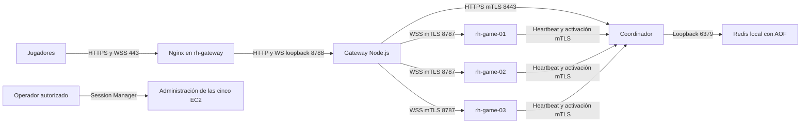

# Red Horizon — Informe completo de servidores AWS

**Fecha de corte:** 17 de noviembre de 2026.  
**Repositorio:** `/Users/dylanrodriguez/Documents/redhorizon/RedHorizon`.  
**Rama de integración:** `main`.  
**Región:** `us-east-2` (Ohio).  
**Sitio público:** https://redhorizon.lat.

Este documento consolida lo solicitado, lo implementado, la configuración, las pruebas y los pendientes. Las comprobaciones de infraestructura son de lectura; preparar este informe no reinició servicios ni modificó DNS. No contiene contraseñas, tokens ni claves privadas.

## 1. Objetivo y alcance solicitado

Implementar cinco EC2 para distribuir nuevas partidas multijugador de Node.js/WebSocket entre tres servidores autoritativos, con acceso administrativo protegido, límites de tráfico y despliegue reproducible.

Condiciones principales:

- Reutilizar `RedHorizon`, ID `i-0db322d7e36dea80a`, dentro de las cinco máquinas; preservar sus datos y tipo inicial `m7i-flex.large`.
- Crear cuatro instancias adicionales: gateway, dos workers y coordinador.
- No modificar `redhorizon_last` ni `superkanes`.
- Enrutar por código de sala y propietario; no repartir aleatoriamente a los miembros de una misma partida.
- Conservar las conexiones existentes durante actualizaciones mediante drenaje.
- Guardar las PEM únicamente en el directorio indicado por el propietario.
- Usar IaC, artefactos versionados, pruebas reales, documentación, commits con autoría del propietario y publicación en `main`.
- No asumir gratuidad por la etiqueta Free Tier; estimar costos antes de provisionar.
- Mantener el servicio anterior durante la transición. El cambio de DNS quedó a cargo del propietario.
- No prometer alta disponibilidad completa ni recuperación de partidas almacenadas en RAM.

## 2. Estado de entrega

| Requisito | Estado al corte |
|---|---|
| Cinco EC2, incluyendo la principal | Implementado; las cinco están `running` |
| Cinco servicios del clúster | Activos, bajo usuario `redhorizon-cluster` |
| Tres workers y asignación por sala | Implementado y probado |
| HTTPS/WSS público y mTLS interno | Implementado y probado |
| Seguridad de red y ausencia de SSH público | Implementado mediante Security Groups |
| nftables como firewall local | **No implementado: reglas vacías** |
| Administración por Session Manager | Implementada |
| Usuario/rol operativo separado de root | Implementado; MFA humano pendiente |
| Discos raíz activos cifrados e IMDSv2 | Implementado |
| Despliegues, drenaje y rollback | Implementados y probados en el alcance documentado |
| DNS hacia el gateway | Confirmado en Google y Cloudflare; sin AAAA antiguo observado |
| Retirada del servicio antiguo de la principal | **Pendiente** |
| Corrección de texturas y animación | Publicada y verificada en navegador |
| Código integrado y publicado en `main` | Confirmado; acceso GitHub corregido |
| GitHub Actions | Bloqueado antes de ejecutar por facturación de la cuenta |
| Alta disponibilidad, autoscaling y recuperación de partidas en RAM | No implementados |

## 3. Inventario de las cinco EC2

| Rol | ID de instancia | Tipo | IP privada | IP pública |
|---|---|---|---|---|
| `rh-gateway` | `i-050759a4168f12f3b` | `t3.micro` | `172.31.25.69` | `3.23.131.44` |
| `rh-game-01` / principal `RedHorizon` | `i-0db322d7e36dea80a` | `m7i-flex.large` | `172.31.16.183` | `77.113.171.135` |
| `rh-game-02` | `i-0ee8a3a9d7cf9a1f6` | `t3.small` | `172.31.21.170` | `18.118.158.91` |
| `rh-game-03` | `i-0173a548389b00fb6` | `t3.small` | `172.31.22.129` | `3.128.120.165` |
| `rh-coordinator` | `i-06bb1fd55f4634ed3` | `t3.micro` | `172.31.21.151` | `3.16.129.247` |

- VPC: `vpc-0acc002bf61620138`.
- Subred: `subnet-0fde15f950925cb60`.
- Zona de disponibilidad: `us-east-2b`; todo el clúster está en una sola AZ.
- Stack CloudFormation: `redhorizon-cluster`, con protección contra terminación y políticas de retención.
- Nuevas instancias: Ubuntu 24.04 de Canonical. La principal conserva Ubuntu 26.04.
- Runtime empaquetado: Node.js Linux 22.23.5, con descarga verificada por SHA-256.
- Cada raíz activa: gp3 cifrado de 20 GiB.
- T3 configuradas en modo Standard: se evita el cargo de créditos excedentes de Unlimited, pero puede reducirse CPU al agotar créditos.
- Las IP públicas son automáticas: un stop/start puede cambiarlas. No hay Elastic IP reservada.

Las otras instancias, excluidas de los cambios, son `redhorizon_last` (`i-040ec54792a8b4446`) y `superkanes` (`i-0b97588c8e4e85881`). La cuenta tiene siete EC2 incluyendo esas dos; el clúster tiene cinco.

## 4. Arquitectura y responsabilidades



**Gateway:** entrega HTML, JavaScript, CSS y modelos; termina TLS público; aplica límites HTTP; valida el ingreso WebSocket y abre el túnel hacia el propietario autorizado.

**Workers:** mantienen salas en memoria, ejecutan la simulación autoritativa, validan acciones, emiten snapshots y reportan carga. Un proceso es dueño de cada sala.

**Coordinador:** reserva capacidad y códigos, mantiene el directorio, comprueba identidad de servicios y excluye workers no elegibles. Redis guarda coordinación, no la simulación completa.

El coordinador se consulta para asignación/búsqueda; no está en el camino de cada input de una partida ya conectada.

## 5. Red, Security Groups y firewall local

| Grupo | ID | Entrada |
|---|---|---|
| Gateway | `sg-0929579efb3434239` | TCP 80/443 desde Internet |
| Game | `sg-09a457a3eab1df5bd` | TCP 8787 solo desde Gateway |
| Coordinator | `sg-01d10d3f03ff7797f` | TCP 8443 solo desde Gateway y Game |

Servicios adicionales:

- Gateway Node.js: `127.0.0.1:8788`, accesible por Nginx local.
- Redis: `127.0.0.1:6379`, sin entrada en los Security Groups.
- SSH: no hay reglas de entrada TCP 22 del clúster. Las PEM no implican un puerto público abierto.
- Workers y API del coordinador escuchan en sus IP privadas.

**Excepción de transición:** la principal conserva los grupos Game + Gateway, así como Caddy/backend anteriores activos. `redhorizon-deploy.timer` está inactivo. Se debe retirar esta entrada al completar el cierre del legado.

**Salida:** HTTP/HTTPS hacia Internet para SSM, paquetes y certificados; reglas adicionales entre grupos para los puertos internos. Se usan IPv4 públicas restringidas para evitar introducir NAT Gateway. Las llamadas internas usan IP privadas de la misma AZ. No se añadieron NAT, ALB, EKS, endpoints de interfaz ni una base de datos administrada.

**Firewall local comprobado en las cinco máquinas:**

| Herramienta | Estado observado |
|---|---|
| nftables | Instalado; ruleset sin reglas |
| UFW | Inactivo |
| iptables | INPUT/FORWARD/OUTPUT con política ACCEPT, sin reglas adicionales mostradas |

La protección implementada está en Security Groups, direcciones de escucha, mTLS y validaciones de aplicación. No se debe presentar el sistema como protegido también por nftables ni afirmar una certificación CIS.

## 6. Acceso administrativo, IAM y bastionado

No hay una sexta EC2 dedicada como bastión. La administración utiliza AWS Systems Manager / Session Manager.

- Perfil habitual: `rh-cluster-operator`.
- Usuario IAM de origen dedicado que asume un rol operativo acotado al clúster.
- La identidad operativa desplegada usa `RedHorizonClusterBootstrapOperator`; la plantilla `operator-role.json` contempla otra configuración con MFA y no demuestra que MFA esté ya enrolado.
- Root se utilizó durante el aprovisionamiento inicial; no se copiaron sus credenciales a servidores, repositorio o artefactos.
- MFA del operador humano: pendiente.
- SSH sobre Session Manager para transferencias, con clave de host verificada; no se desactiva `StrictHostKeyChecking`.
- Runtime bajo usuario de sistema `redhorizon-cluster`, sin shell de login.
- Configuración no secreta separada de los archivos TLS.
- IMDSv2 obligatorio; hop limit 1 en las cinco instancias.

Protecciones systemd del servicio:

- `NoNewPrivileges`, `PrivateTmp`, `PrivateDevices`, `ProtectHome` y `ProtectSystem=strict`.
- Protección de parámetros/módulos del kernel y grupos de control.
- Restricciones de SUID/SGID, familias de sockets y personalidad del proceso.
- `UMask=0077`, directorio de ejecución privado y límite de 128 tareas.
- `LimitNOFILE=4096`.
- Límite de memoria del proceso: 650 MiB en gateway/coordinador; 1.200 MiB en workers. No es el límite global de toda la EC2; Redis y Nginx son servicios aparte.
- Reinicio por fallo con espera de cinco segundos; no reemplaza el drenaje ni recupera salas en memoria.
- Actualizaciones de seguridad configuradas sin reinicio automático del sistema; reinicios de servicios deben coordinarse con drenaje.

## 7. Llaves, secretos y certificados

Directorio exclusivo de material privado local:

```text
/Users/dylanrodriguez/Documents/redhorizon/llaveredhorizon
```

- Directorio con permisos `700`.
- Cuatro PEM nuevas con permisos `600`, nombres por rol y sufijo `20261116T234246Z.pem`.
- La PEM existente de la principal se conserva con permisos restrictivos `400`.
- No se sobrescribieron llaves existentes ni se descargó nuevamente una clave privada preexistente de EC2.
- Claves y evidencias sensibles excluidas de Git, imágenes, logs y artefactos públicos.
- PKI activa: subdirectorio `cluster-20261117-strict`.
- La CA privada permanece en el Mac. Cada host recibe solo su clave/certificado y la CA pública.

**TLS público:** Nginx, TLS 1.2/1.3, certificado Let’s Encrypt para apex/www, vencimiento documentado 14/02/2027. Certbot y recarga configurados; renovación simulada aprobada.

**TLS interno:** conexiones WSS/HTTPS con mTLS, validación de CA y SAN, e identidad permitida por servicio. La red privada no sustituye esta autenticación. Certificados de servicio de 90 días y CA de 365 días. Rotación/revocación automáticas no implementadas.

La PKI se corrigió después de detectar rechazo de un cliente X.509 estricto: se añadieron explícitamente CA v3, restricciones/usos de firma y SKI/AKI. No se desactivó la validación TLS para resolverlo.

## 8. Distribución de salas y WebSocket

1. El gateway recibe `create`, `join` o `reconnect` y valida protocolo/origen/límites.
2. Para crear, el coordinador ejecuta una reserva atómica mediante Lua en Redis.
3. Selecciona un worker saludable, sin drenaje, con capacidad libre y carga admisible.
4. Registra código, propietario, identificador de arranque, token de reserva y vigencia.
5. El worker consume la reserva una sola vez antes de crear la sala.
6. Los demás participantes consultan ese propietario y llegan al mismo proceso.

| Parámetro | Valor |
|---|---:|
| Reserva provisional | 15 s |
| Heartbeat del worker | Cada 5 s |
| Elegibilidad sin nuevo heartbeat | Menos de 15 s |
| Vigencia renovada de sala activa | 45 s |
| Retención de registros retirados | Hasta 3 h según el estado del directorio |
| Recuperación de identidad del jugador | 30 s |
| Token de reconexión | 256 bits aleatorios |
| Ping/pong de transporte | Cada 10 s |

Los identificadores de destino se limitan a `rh-game-01`, `rh-game-02` y `rh-game-03`. No se aceptan IP/URL arbitrarias del cliente. Una pista de reconexión identifica al propietario, pero este sigue validando el token.

El identificador de arranque evita tratar un proceso nuevo como propietario válido de las salas del proceso anterior. No se migran salas activas en memoria entre workers.

## 9. Rate limiting y protección de recursos

| Capa | Límite |
|---|---|
| HTTP Nginx | 30 solicitudes/s por IP; ráfaga 100 en contenido y 10 en salud |
| Handshake WebSocket Nginx | 1/s por IP, ráfaga 10 |
| Conexiones simultáneas por IP | 12 |
| Gateway Node.js | 256 conexiones totales como tope defensivo |
| Admisión de conexiones en gateway | Token bucket, ráfaga 20 y recarga 1/s por IP |
| Creación en gateway | Ráfaga 4, recarga 8/min por IP |
| Unión y reconexión en gateway | Presupuestos separados: ráfaga 12 y recarga 40/min por IP |
| Worker: nuevas conexiones | 60/min por IP |
| Worker: acceso a salas | 40/min por IP; creación adicionalmente 8/min |
| Mensajes WebSocket | 150/s por sesión, comprobados en gateway y worker |
| Tamaño entrante WebSocket | 4.096 bytes, incluso después de descomprimir |
| Cola pendiente gateway → worker | Corte al superar 64 KiB |
| Cola pendiente hacia cliente | Corte al superar 1 MiB |
| Cuerpo HTTP público | 8 KiB |
| Cuerpo API del coordinador | 16 KiB |
| API del coordinador | 64 conexiones; timeouts de cabecera/petición de 5 s |

Los token buckets permiten ráfaga inicial y recuperan capacidad a la tasa indicada; no equivalen a ventanas rígidas con el mismo máximo.

Nginx sobrescribe `X-Real-IP` y `X-Forwarded-For`; el gateway solo acepta el proxy local y los workers requieren la identidad mTLS del gateway. Durante la transición existe confianza explícita en la IP privada de la principal para el proxy legado. Revisar esa excepción al retirarlo.

Usuarios detrás de un NAT comparten IP y presupuestos. Los límites se probaron con usuarios simultáneos, pero requieren más medición antes de admitir grupos mayores. No hay una defensa volumétrica completa ante DDoS.

## 10. Seguridad del juego y del frontend

- Simulación autoritativa en backend: el cliente envía acciones, no decide resultados.
- Validación de JSON, tipos, campos admitidos, versiones, secuencias, controles, valores finitos y dirección de apuntado.
- Rechazo de mensajes binarios, campos inesperados, identidad inválida y operaciones sin permiso.
- Reglas de creación/unión, capacidad de cuatro jugadores por sala e inicio por el anfitrión con participantes listos.
- Cierre de clientes lentos, conexiones inactivas y sesiones que exceden límites.
- Sin tokens de sesión ni secretos en logs de aplicación; access log de `/ws` desactivado.
- CSP, HSTS, `X-Content-Type-Options`, `X-Frame-Options` y `Referrer-Policy`.
- Archivos ocultos y ruta `/runtime` bloqueados por Nginx.

**Incidencia gráfica corregida:** la CSP impedía `fetch(blob:...)` de texturas embebidas en GLB. Se reprodujeron 67 infracciones, pese a descargar los modelos con HTTP 200. Se añadió `blob:` a `connect-src`, conservando el resto de restricciones. La repetición tuvo cero infracciones y cero errores de textura.

## 11. Rendimiento y capacidad medida

- Simulación: 60 Hz.
- Snapshots de red: 10 Hz.
- JSON reutilizado para un mismo snapshot distribuido a varios jugadores.
- Precisión de posiciones transmitidas acotada a un milímetro, sin reducir la precisión de la simulación.
- Compresión WebSocket pública, sin historial compartido entre mensajes; límite de descompresión conservado.
- Gzip para recursos HTTP compatibles; caché larga para assets versionados.
- Compilación y pruebas fuera de las EC2 de partidas.
- Interpolación visual de tiempo, posiciones, proyectiles y cinemática. Los enemigos ya no avanzan su animación únicamente al llegar un snapshot de 10 Hz.

**Capacidad habilitada:** una sala de hasta cuatro jugadores por worker; tres salas y doce jugadores en conjunto. El tope de 256 conexiones no es capacidad certificada de partidas.

La selección considera salas/capacidad y carga basada en CPU/event loop. La principal dispone de más recursos, pero no se le asignaron más salas por intuición. El renderizador de configuración usa capacidad cero si falta una medición aprobada.

| Ensayo de 120 s, 12 jugadores | Resultado |
|---|---|
| Dentro de la VPC | 12/12 conexiones, cero errores, RTT p95 5,02 ms; p99 38,20 ms |
| Desde el Mac hacia gateway | 12/12 conexiones, cero errores, RTT p95 123,49 ms; p99 143,51 ms |

El generador interno compartía la principal. No es una certificación de capacidad máxima. Hubo ensayos iniciales fallidos que se conservaron; no se redujeron los criterios para declararlos aprobados. Faltan campañas prolongadas y pruebas hasta agotar créditos de CPU. Los FPS dependen también del equipo, GPU, navegador y calidad gráfica del jugador.

## 12. Redis y almacenamiento

Redis escucha exclusivamente en loopback, con `protected-mode`, AOF, `appendfsync everysec`, límite 128 MB y política `noeviction`. No hay una capa de ACL/credenciales Redis descrita como implementada; el aislamiento desplegado es local. La persistencia del directorio no guarda ni recupera las partidas completas.

La raíz principal fue sustituida por una cifrada preservando instancia, IP y datos, con snapshot consistente, verificación de hashes y recuperación prevista.

| Elemento de la principal | Identificador / estado |
|---|---|
| Raíz activa cifrada | `vol-0ad96b0c2a48bea88` |
| Raíz original retenida, separada y sin cifrar | `vol-0cb0eae776043b3fd` |
| Snapshot previo retenido | `snap-06ec86622619fd83b` |
| Tarea de reemplazo completada | `replacevol-00235f7ae161bf7aa` |

Las copias históricas anteriores al cifrado requieren una decisión de retención. No hay política periódica de backups y recuperación integral documentada como desplegada. No borrar esos recursos como parte de una limpieza automática.

## 13. Observabilidad y logs

Métricas de workers cada cinco segundos: salas, conexiones, mensajes, bytes, rechazos, RSS, CPU, duración de simulación y p99 del event loop. El campo de jugadores se basa en conexiones del proceso; no debe confundirse con usuarios humanos únicos.

- Estado local: `/run/redhorizon-cluster/status.json`.
- Logs: journald, retención de siete días y máximo 100 MiB.
- Nginx: siete rotaciones, compresión y umbral 10 MiB revisado cada hora.
- CloudWatch estándar: CPU, créditos T3 y tráfico de red.
- Sin métricas personalizadas de pago, alertas externas automáticas ni operación 24/7 implementadas.

## 14. Despliegue reproducible y versiones activas

| Elemento | Versión al corte |
|---|---|
| Runtime de las cinco EC2 | `e1fb054af8a3a06f379a3d931ce18630f8e43583` |
| Frontend público corregido | `46db0d794527c7bb084fab4db518f544c7efc723` |
| Rama de integración | `main`, publicada en GitHub |

El frontend puede actualizarse independientemente cuando sigue siendo compatible con el protocolo del backend. Un commit nuevo de documentación no exige desplegar otra vez la aplicación.

Rutas relevantes:

| Ruta en servidor | Uso |
|---|---|
| `/srv/redhorizon-cluster/releases/` | Releases completas |
| `/srv/redhorizon-cluster/current` | Enlace al runtime activo |
| `/srv/redhorizon-cluster/frontend-releases/` | Frontends independientes |
| `/etc/redhorizon-cluster/cluster.json` | Configuración no secreta por host |
| `/etc/redhorizon-cluster/tls/` | Identidad TLS de ese host |
| `/var/lib/redhorizon-cluster/drain` | Marcador de drenaje |
| `/etc/nginx/conf.d/redhorizon.conf` | Entrada pública |

El artefacto completo incluye frontend, runtime, dependencias fijadas por lockfile y Node Linux verificado. Los deltas verifican todos los hashes de la release reconstruida; desligan archivos modificados antes de escribir para preservar el rollback.

El último frontend se publicó con un delta de 823.729 bytes y 113 archivos verificados. Se validó y recargó Nginx sin reiniciar Node ni workers; se conservaron assets antiguos para pestañas abiertas. El navegador debe recargar para obtener el nuevo JS y la nueva CSP.

## 15. Operación, despliegue, recuperación y apagado

Ejecutar desde la raíz del repositorio. Los nombres en MAYÚSCULAS son valores que el operador debe sustituir, no comandos listos para copiar sin revisión.

### Inspección sin cambios

```sh
aws sts get-caller-identity --profile rh-cluster-operator
aws ssm describe-instance-information --region us-east-2 --profile rh-cluster-operator
python3 scripts/cluster/verify-private-network.py
python3 scripts/cluster/observe.py
curl -fsS https://redhorizon.lat/health
curl -fsS https://redhorizon.lat/frontend-release.json
```

### Construcción y actualización de workers

```sh
bash scripts/cluster/package.sh "$PWD/.cluster-local/artifacts"
python3 scripts/cluster/make-delta.py NUEVO.tar.gz DELTA.tar.gz --base ANTERIOR.tar.gz
python3 scripts/cluster/rollout.py DELTA.tar.gz --delta --release REVISION --hosts rh-game-02 rh-game-03 rh-game-01
```

El rollout deja de asignar salas nuevas, espera cero salas, actualiza, comprueba salud mTLS y espera que el coordinador admita la nueva encarnación. Plazo de drenaje: 7.500 s; al vencer no mata automáticamente partidas. Gateway y coordinador requieren cero túneles, ventana de mantenimiento y `--allow-entry-interruption` para actualizaciones de runtime.

### Frontend compatible sin reiniciar partidas

```sh
python3 scripts/cluster/deploy-frontend.py NUEVO.tar.gz --base ARTEFACTO_BASE.tar.gz --release COMMIT_COMPLETO --compatible-runtime COMMIT_BACKEND
```

El script verifica hashes, cambia la raíz estática de Nginx y hace reload gradual. Un rollout completo del backend no cambia automáticamente una raíz estática independiente: revisar expresamente qué frontend sirve Nginx.

### Rollback

- Worker: drenar, esperar cero salas, restaurar release anterior, verificar mTLS y reabrir admisión. No recuperar salas de RAM mediante una promesa de rollback.
- Frontend: restaurar `/srv/redhorizon-cluster/nginx-before-frontend-COMMIT.conf` como configuración activa, ejecutar `nginx -t` y recargar Nginx.
- Coordinador: recuperar servicio y Redis/AOF; comprobar asignación y heartbeats.
- Retorno público al legado: requiere decidir DNS, grupos de seguridad, Caddy/backend anteriores y salas activas; no es una migración automática de sesiones.

### Apagado del laboratorio

```sh
python3 scripts/cluster/stop-lab.py
# Solo después de drenaje, cero salas/túneles y decidir el destino del sitio:
python3 scripts/cluster/stop-lab.py --execute
```

Se deben drenar los tres workers manteniéndolos vivos para que el script lea un estado fresco; no confundir esto con el script que drena y detiene para desplegar. El apagado detiene únicamente las cuatro EC2 nuevas; excluye principal y otras cargas. Como el dominio ya usa el gateway, detenerlo deja el sitio inaccesible si no se prepara antes una alternativa. EBS sigue facturando y las IP públicas pueden cambiar al arrancar.

### Certificados y restauración

Renovar certificados internos antes de expirar. La rotación de CA requiere transición de confianza; la herramienta de rotación con todo el clúster vacío es mantenimiento con interrupción, no renovación transparente. Una restauración desde un snapshot antiguo necesita la PKI vigente antes de admitir partidas. La CA privada nunca se distribuye.

## 16. DNS y transición: situación actual

La consulta del 17/11/2026 a Google y Cloudflare confirmó:

- `redhorizon.lat` → A `3.23.131.44`.
- `www.redhorizon.lat` → CNAME `redhorizon.lat`, resuelto al mismo gateway.
- Sin direcciones AAAA observadas; TTL devuelto de 600 s.
- El sitio público responde con el gateway y el frontend corregido.

**Pendiente:** retirar Caddy/backend legados y el grupo Gateway de la principal. Se confirmaron ambos servicios anteriores activos y el timer de despliegue anterior inactivo. Este informe no los detuvo.

`finalize-dns.py` verifica dos resolutores, salud pública y cero salas legadas antes de retirar esa entrada cuando se ejecute con `--execute`. Consultar el procedimiento en [RUNBOOK.md](RUNBOOK.md). En el Python del Mac se observó un almacén CA sin configurar: usar un almacén confiable válido, como el de certifi ya instalado, sin desactivar la verificación TLS.

Las salas antiguas y nuevas no comparten directorio. Sus códigos/tokens no se transfieren entre sistemas. No cortar el legado mientras queden partidas que deban terminar.

## 17. Pruebas y resultados reales

| Verificación | Resultado registrado |
|---|---|
| Suite local final | 194 pruebas en 38 archivos aprobadas; lint y build aprobados |
| Red privada desde EC2 | 18/18 comprobaciones aprobadas |
| Puertos públicos 22/8787/8443/6379 | 20 sondas bloqueadas |
| Creación/unión y propietario por código | Aprobado |
| Distribución entre tres workers | Aprobada |
| Reconexión al mismo propietario | Aprobada |
| Coordinador detenido en entorno candidato | Partidas establecidas y reconexión con pista sobrevivieron; creación nueva rechazada |
| Worker reiniciado en candidato | Solo sus salas se perdieron; sin falsa recuperación |
| Drenaje y actualización/rollback | Probados con las condiciones descritas |
| Abuso por sesión | Límite aplicado mientras otro cliente legítimo seguía respondiendo |
| Mensaje comprimido de 5.000 bytes | Rechazado por máximo descomprimido de 4.096 |
| PKI | Validación X.509 estricta aprobada después de corregir SKI/AKI |
| Texturas/CSP | 67 bloqueos antes; cero después |
| Regresión gráfica | Mapas decodificados y AnimationMixer avanzando entre snapshots |
| Navegadores contra dominio público | Individual y dos clientes online aprobados tras la corrección |

Las pruebas de fallos/carga ocurrieron cuando el clúster era candidato aislado. No deben repetirse sobre producción con jugadores. La prueba online original no capturaba errores de textura en consola; se corrigió esa carencia y se volvió a validar. Los primeros ensayos fallidos se conservan como evidencia, no se contabilizan como aprobados.

Evidencias extensas en [PRUEBAS-EC2-2026-11-17.md](PRUEBAS-EC2-2026-11-17.md) y [VALIDATION.md](VALIDATION.md). Los JSON/logs operativos completos están en `.cluster-local/`, excluidos de Git; no se publican secretos para demostrar resultados.

## 18. Costos y Free Tier

**Estimación histórica del 16/11/2026**, no factura ni cotización actualizada. Base: Linux On-Demand, 730 horas/mes, sin impuestos, descuentos/créditos, transferencia ni cargos opcionales. Las tarifas y beneficios deben volver a comprobarse antes de tomar nuevas decisiones de gasto.

| Concepto | USD/mes estimados |
|---|---:|
| Cuatro EC2 nuevas: 2 micro + 2 small | 45,55 |
| Cuatro discos nuevos de 20 GiB | 6,40 |
| Cuatro IPv4 nuevas | 14,60 |
| Incremento por las cuatro nuevas | **66,55** |
| Principal: EC2 + disco activo + IPv4 | 75,15 |
| Disco original de 8 GiB retenido | 0,64 |
| Base de las cinco EC2 | **142,35** |
| Snapshot previo | Hasta aproximadamente 0,40 adicionales |
| Cuenta con las otras dos EC2 existentes | **228,42**, antes de extras |

Tarifas utilizadas: t3.micro 0,0104 USD/h; t3.small 0,0208 USD/h; m7i-flex.large 0,09576 USD/h; gp3 0,08 USD/GiB-mes; IPv4 0,005 USD/h.

Último crédito documentado: **USD 74,06**, consultado el 16/11, con vencimiento informado `2027-05-10T20:16:19.490Z`, o antes al agotarse. No es saldo en tiempo real. Cost Explorer no permitió obtener gasto monetario histórico; las métricas de CPU/tráfico no son una factura.

La salida de datos y descargas de modelos pueden ser importantes. El cálculo histórico usó un cupo agregado de 100 GB/mes y aproximadamente 0,09 USD/GB en el primer tramo posterior; no es un cupo por instancia. El ensayo documentado proyectaba unos USD 141 extra si se mantuviera exactamente su tráfico las 730 h del mes, sin otros consumos del cupo. Es un escenario de ocupación constante, no gasto observado.

Se compararon cuatro IPv4 (14,60 USD/mes) con NAT Gateway (32,85 USD/mes de base, más IPv4 y procesamiento). No se creó NAT automáticamente. El modo T3 Standard limita gasto de créditos excedentes, no garantiza rendimiento sostenido ilimitado.

**Cinco EC2 de estos tipos no deben describirse como gratuitas.** Ver supuestos y fuentes de la estimación en [COSTS.md](COSTS.md).

## 19. Git, CI y archivos de implementación

Los cambios se integraron y publicaron en `main`; se conservaron autoría y commits del propietario. GitHub CLI quedó autenticado como `DylanSantiagoRodriguez` con escritura. Las ramas antiguas no sustituyen a `main` como integración.

GitHub Actions intentó validar los commits, pero GitHub bloqueó el inicio del job por un problema de facturación de la cuenta. No ejecutó pasos; no debe presentarse ese resultado como pruebas de código fallidas ni como CI aprobado. No se modificó facturación ni se desactivaron comprobaciones.

| Archivo / directorio | Responsabilidad |
|---|---|
| [infrastructure.json](../../deploy/cluster/infrastructure.json) | CloudFormation de la infraestructura |
| [nginx.conf](../../deploy/cluster/nginx.conf) | Entrada, CSP, TLS y límites HTTP |
| [redhorizon-cluster.service](../../deploy/cluster/redhorizon-cluster.service) | Usuario, aislamiento y recursos systemd |
| [server/cluster](../../server/cluster) | Gateway, coordinador, TLS, limitadores y directorio Lua |
| [server.js](../../server/server.js) | Backend WebSocket autoritativo y límites por sesión |
| [RoomManager.js](../../server/RoomManager.js) | Salas, participantes y reconexión |
| [OnlineGame.js](../../src/network/OnlineGame.js) | Cliente online, reconciliación y presentación interpolada |
| [scripts/cluster](../../scripts/cluster) | Construcción, configuración, despliegue, pruebas y recuperación |
| [graphics-policy.spec.js](../../tests/browser/graphics-policy.spec.js) | Regresión de texturas/CSP y animaciones |
| [ci.yml](../../.github/workflows/ci.yml) | Comprobaciones automáticas del repositorio |

## 20. Limitaciones y pendientes explícitos

1. Retirar la entrada legada de la principal tras comprobar cero salas antiguas.
2. Decidir e implementar firewall local nftables si se requiere esa segunda capa; actualmente no existe.
3. Enrolar MFA humano y completar la transición de identidad operativa correspondiente.
4. Resolver el bloqueo de facturación de GitHub para ejecutar CI remoto.
5. Rotar la PKI interna antes de caducar; automatización/revocación pendientes.
6. Definir retención del volumen y snapshot históricos sin cifrar y una política periódica de backups.
7. Añadir alertas operativas si se necesita detección y respuesta automática.
8. Medir campañas largas, concurrencia mayor y agotamiento de créditos antes de aumentar capacidad.
9. Revisar límites bajo NAT compartida y salidas de red para operación permanente.
10. Mantener inventario y DNS actualizados después de detener/arrancar EC2.

Una sola entrada, un solo coordinador y una sola AZ siguen siendo puntos únicos de fallo. No hay autoscaling ni recuperación de partidas perdidas en RAM. El reinicio automático no garantiza continuidad de una partida. La infraestructura distribuye capacidad entre salas; no garantiza por sí sola FPS altos en todos los equipos ni latencia constante de Internet.
