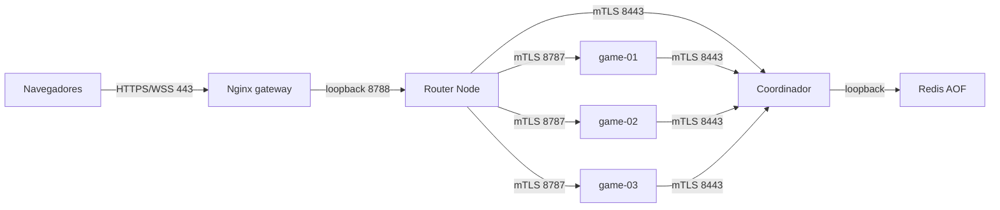

# Red Horizon: arquitectura de cinco EC2

Estado al 16 de noviembre de 2026 (Bogotá): cuatro EC2 nuevas creadas y principal conservada. Ver [inventario real](INVENTORY.md), [validación](VALIDATION.md), [costos](COSTS.md) y [operación](RUNBOOK.md). El propietario realizó el cambio de DNS, verificado el 17/11/2026; queda pendiente cerrar la entrada legada. Estado consolidado en [INFORME-COMPLETO-SERVIDORES.md](INFORME-COMPLETO-SERVIDORES.md).

Cuenta `670036769494`, región `us-east-2`, VPC `vpc-0acc002bf61620138`, subred `subnet-0fde15f950925cb60`, AZ `us-east-2b`. Cuota estándar: 16 vCPU; las siete EC2 de la cuenta suman 14. Cuatro nodos Ubuntu 24.04 Canonical, AMI `ami-096d6538c463eb1db`; la principal conserva Ubuntu 26.04.

Las instancias redhorizon_last y superkanes y su grupo compartido no se modificaron. La principal salió de ese grupo; conserva temporalmente Game + Gateway durante la transición. Su disco activo es ahora gp3 cifrado de 20 GiB; el original se conserva separado. Las cinco usan IMDSv2 y SSM. Operación diaria con `rh-cluster-operator`, sin credenciales de root en EC2.

## Arquitectura y red

Tres SG nuevos: Gateway 80/443 Internet; Game 8787 solo Gateway; Coordinator 8443 solo Gateway y Game. Redis no se expone. Administración SSM sin SSH público. PEM de recuperación no implican que exista un puerto SSH abierto.

Conectividad económica inicial: IP pública por nodo y subred pública, con entradas restringidas por SG; las llamadas internas usan IP privada. Salidas HTTP/HTTPS para repositorios, SSM y certificados; reglas adicionales entre SG para mTLS. DNS mediante resolvedor de VPC. No se crean NAT, endpoints de interfaz, ALB, EKS, bases administradas, EIP ni métricas CloudWatch personalizadas. Un reinicio stop/start puede cambiar IP pública: refrescar inventario y DNS; no afirmar IP estable.

Una sola AZ, gateway y coordinador son puntos únicos de fallo. TLS privado usa una CA fuera del repo y certificados por servicio de 90 días, validación de SAN y autenticación por CN. No se distribuye la CA privada. Rotar antes de expirar y conservar el bundle de CA anterior durante la transición. Esto no proporciona revocación automática.

## Distribución y fallos

El gateway valida el primer mensaje y solicita una reserva atómica de código/servidor/token. Un script Lua en Redis selecciona entre procesos con heartbeat reciente, capacidad explícita y carga admisible. La activación consume el token una sola vez antes de crear la sala.

Las nuevas reservas expiran en 15 s. Heartbeat cada 5 s; trabajador elegible durante 15 s. Las salas activas renuevan su vigencia durante 45 s. Se conservan registros/tombstones durante 3 h para evitar reutilizar códigos de partidas aún vivas durante particiones. El proceso tiene un identificador de arranque: dos procesos del mismo servidor no pueden anunciarse simultáneamente; los arranques retirados quedan cercados.

El gateway conserva el túnel por conexión; no consulta el coordinador por cada input. El cliente guarda `serverId` junto con su identidad de reconexión y solo permite tres IDs conocidos. El servidor de destino sigue validando el token de reconexión de 256 bits. Esto permite reconexión directa durante una caída del coordinador, mientras vive el mismo proceso y dentro del plazo de 30 s.

La caída del coordinador rechaza nuevas asignaciones y búsquedas. Una caída de Redis conserva los túneles; AOF permite recuperar directorio, no simulación. La pérdida del disco de Redis o una reserva parcialmente confirmada puede exigir recrear sala: no se garantiza continuidad bajo todos los fallos. Una caída de worker pierde sus partidas. Un gateway caído rompe las conexiones; reconectar depende del plazo y del proceso propietario.

Capacidad inicial ensayada: **1 sala de hasta 4 jugadores por worker**, tres salas/12 jugadores en total. El renderizador sigue usando cero si no se entrega evidencia de capacidad. La asignación combina salas/capacidad con CPU y event loop medidos: la principal mostró menor CPU/tiempo de paso. No se extrapola su mayor RAM a un número arbitrario de salas; subir su capacidad requiere otra prueba. La prueba de 120 s no certifica campañas prolongadas ni capacidad máxima.

## Seguridad y rendimiento

Nginx sobrescribe IP de origen y limita handshakes; Node gateway escucha solo loopback. Workers solo confían en certificados de rh-gateway. Límites por IP/operación, mensajes de 4 KiB, 150 mensajes/s por conexión, tamaño de colas y validación del protocolo. No se usa Origin como autenticación exclusiva.

Artefactos construidos fuera de producción con Node Linux fijado y verificado por SHA-256. El runtime permanece en usuario sin privilegios con systemd, límites de memoria y logs de 100 MiB/7 días. Los límites de Nginx son valores iniciales, sujetos a pruebas de usuarios reales bajo NAT compartida.

Las métricas locales incluyen conexiones, salas, mensajes, bytes, rechazos, RSS, CPU, retraso p99 y tiempo de paso. CloudWatch EC2 permite consultar créditos T3 mediante las métricas existentes. No se ha configurado aún un servicio externo de alertas ni un SOC.

No se garantiza resistencia volumétrica DDoS con un proxy micro. Los FPS dependen del cliente; repartir salas aumenta capacidad agregada, no mejora automáticamente un frame ni una partida individual.
