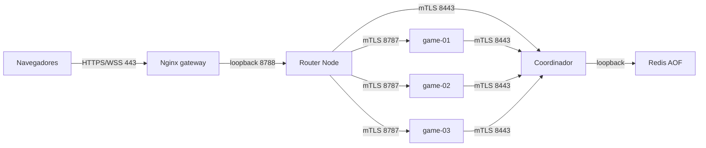

# Red Horizon: plan de cinco EC2

Estado: implementación local en preparación; recursos nuevos, identidad IAM operativa, DNS y migración **pendientes de presupuesto aprobado**. No se han creado instancias, pares AWS ni modificado grupos existentes.

## Inventario comprobado el 16 de noviembre de 2026

Cuenta `670036769494`, región `us-east-2`, perfil `default` autenticado como root.

| Función | Instancia | Tipo | Estado |
|---|---|---|---|
| rh-game-01 | i-0db322d7e36dea80a / RedHorizon | m7i-flex.large | Existente; conservar |
| rh-gateway | Por crear | t3.micro | Presupuesto pendiente |
| rh-game-02 | Por crear | t3.small | Presupuesto pendiente |
| rh-game-03 | Por crear | t3.small | Presupuesto pendiente |
| rh-coordinator | Por crear | t3.micro | Presupuesto pendiente |

Fuera del alcance: `i-040ec54792a8b4446` (redhorizon_last), `i-0b97588c8e4e85881` (superkanes). Total futuro de la cuenta: **7 EC2**, de las que 5 corresponden a esta arquitectura.

VPC `vpc-0acc002bf61620138`, subred `subnet-0fde15f950925cb60`, AZ `us-east-2b`, ruta pública mediante IGW existente. Tipo t3.micro y t3.small disponibles en esa AZ según API; disponibilidad instantánea no garantizada. Cuota On-Demand estándar: 16 vCPU; uso previsto de la cuenta: 14.

AMI candidata fijada: `ami-096d6538c463eb1db`, Canonical `099720109477`, Ubuntu 24.04 amd64, imagen `20261108`. Revalidar antes de lanzar. El sistema operativo de la principal no se reemplaza con esta AMI.

La principal tiene Node/Caddy/timer activos, escucha de juego en loopback, revisión desplegada `fe29dd62d420bd961e05b0ae8df37fd5d41743bf` y cero salas en el instante de consulta. Su disco gp3 de 8 GiB **no está cifrado**, el filesystem está al 80 %. No cambiarlo en caliente: la transición al volumen cifrado requiere copia, snapshot cifrado, volumen y parada planificada con rollback. Reservar espacio para los dos despliegues durante la convivencia.

El SG actual `sg-07ad97ea1e7355e62` permite 22/80/443 públicos y es compartido por las tres instancias existentes. **No editar sus reglas**. Crear SG exclusivos, adjuntar primero a la principal para pruebas y retirar el SG compartido únicamente después del cambio de tráfico y de validar SSM. Adjuntar un SG nuevo no elimina permisos del anterior.

No hay nodos registrados en SSM ni usuarios IAM dedicados. Solo se observaron roles vinculados a servicios. El rol operativo preparado requiere crear/configurar una identidad IAM con MFA; no contiene claves de acceso. Root no debe ser la identidad operativa diaria.

## Arquitectura y red

Tres SG nuevos: Gateway 80/443 Internet; Game 8787 solo Gateway; Coordinator 8443 solo Gateway y Game. Redis no se expone. Administración SSM sin SSH público. PEM de recuperación no implican que exista un puerto SSH abierto.

Conectividad económica inicial: IP pública por nodo y subred pública, con entradas restringidas por SG; las llamadas internas usan IP privada. Salidas HTTP/HTTPS para repositorios, SSM y certificados; reglas adicionales entre SG para mTLS. DNS mediante resolvedor de VPC. No se crean NAT, endpoints de interfaz, ALB, EKS, bases administradas, EIP ni métricas CloudWatch personalizadas. Un reinicio stop/start puede cambiar IP pública: refrescar inventario y DNS; no afirmar IP estable.

Una sola AZ, gateway y coordinador son puntos únicos de fallo. TLS privado usa una CA fuera del repo y certificados por servicio de 90 días, validación de SAN y autenticación por CN. No se distribuye la CA privada. Rotar antes de expirar y conservar el bundle de CA anterior durante la transición. Esto no proporciona revocación automática.

## Distribución y fallos

El gateway valida el primer mensaje y solicita una reserva atómica de código/servidor/token. Un script Lua en Redis selecciona entre procesos con heartbeat reciente, capacidad explícita y carga admisible. La activación consume el token una sola vez antes de crear la sala.

Las nuevas reservas expiran en 15 s. Heartbeat cada 5 s; trabajador elegible durante 15 s. Las salas activas renuevan su vigencia durante 45 s. Se conservan registros/tombstones durante 3 h para evitar reutilizar códigos de partidas aún vivas durante particiones. El proceso tiene un identificador de arranque: dos procesos del mismo servidor no pueden anunciarse simultáneamente; los arranques retirados quedan cercados.

El gateway conserva el túnel por conexión; no consulta el coordinador por cada input. El cliente guarda `serverId` junto con su identidad de reconexión y solo permite tres IDs conocidos. El servidor de destino sigue validando el token de reconexión de 256 bits. Esto permite reconexión directa durante una caída del coordinador, mientras vive el mismo proceso y dentro del plazo de 30 s.

La caída del coordinador rechaza nuevas asignaciones y búsquedas. Una caída de Redis conserva los túneles; AOF permite recuperar directorio, no simulación. La pérdida del disco de Redis o una reserva parcialmente confirmada puede exigir recrear sala: no se garantiza continuidad bajo todos los fallos. Una caída de worker pierde sus partidas. Un gateway caído rompe las conexiones; reconectar depende del plazo y del proceso propietario.

Capacidad por worker: **0 por defecto**, hasta calibrar en las máquinas reales. No se extrapola el benchmark del Mac. La asignación normaliza salas/capacidad y observa CPU/event-loop; los diferentes tamaños admiten capacidades distintas después de medir.

## Seguridad y rendimiento

Nginx sobrescribe IP de origen y limita handshakes; Node gateway escucha solo loopback. Workers solo confían en certificados de rh-gateway. Límites por IP/operación, mensajes de 4 KiB, 150 mensajes/s por conexión, tamaño de colas y validación del protocolo. No se usa Origin como autenticación exclusiva.

Artefactos construidos fuera de producción con Node Linux fijado y verificado por SHA-256. El runtime permanece en usuario sin privilegios con systemd, límites de memoria y logs de 100 MiB/7 días. Los límites de Nginx son valores iniciales, sujetos a pruebas de usuarios reales bajo NAT compartida.

Las métricas locales incluyen conexiones, salas, mensajes, bytes, rechazos, RSS, CPU, retraso p99 y tiempo de paso. CloudWatch EC2 permite consultar créditos T3 mediante las métricas existentes. No se ha configurado aún un servicio externo de alertas ni un SOC.

No se garantiza resistencia volumétrica DDoS con un proxy micro. Los FPS dependen del cliente; repartir salas aumenta capacidad agregada, no mejora automáticamente un frame ni una partida individual.
