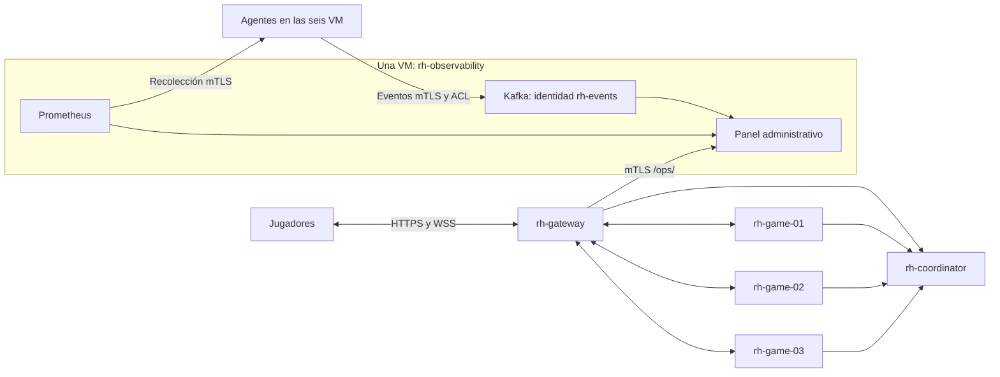

> **Acceso actualizado por solicitud del propietario:** el panel desplegado usa usuario y contraseña, sin código TOTP (`requireMfa: false`). Se conservan roles, límites de intentos, sesiones seguras y mTLS interno. Las referencias a MFA de abajo documentan la configuración y pruebas anteriores; no son un requisito de acceso actual.

# Despliegue AWS compartido — 17/11/2026

La ampliación utiliza **una EC2 nueva**, `rh-observability` (`i-0d5651c3f279e29b3`, `m7i-flex.large`, 8 GiB, privada `172.31.17.191`). Las cinco EC2 del juego se conservan. `rh-events` es la identidad lógica de Kafka en esa misma VM, no una séptima máquina. Las instancias ajenas no forman parte del inventario.

Grupos nuevos: observabilidad `sg-02b0fcbe75579983d` y eventos `sg-02fa23a1ea0ebb595`. Ambos se asocian al host compartido. Métricas 9400 solo desde observabilidad; panel 8444 solo desde gateway; Kafka 9093 solo desde los grupos autorizados. Prometheus 9090, métricas del panel 9401 y controlador Kafka 9094 en loopback. Administración mediante Session Manager, sin abrir SSH público.

Acceso previsto al finalizar las verificaciones: `https://redhorizon.lat/ops/`. Usuarios admin y reader con contraseña y TOTP obligatorio. Credenciales y URI de inscripción están exclusivamente en el archivo local privado `llaveredhorizon/observability-access-20261117/enrollment.json`; no se publican aquí. La PKI independiente está en `llaveredhorizon/observability-production-20261117`, permisos restrictivos. La CA privada nunca se copia a AWS.

Retención: Prometheus 7 días/10 GB; eventos SQLite 7 días/50.000 entradas; Kafka 24 horas/256 MiB por partición de topic, segmentos 16 MiB. Docker limita logs a 3 archivos de 10 MB por contenedor; journal 100 MB/7 días. No hay alta disponibilidad de observabilidad ni del broker. Los productores tienen colas acotadas y descartan telemetría cuando falla su destino; la simulación no espera a Kafka.

## Recuperación y apagado

Gestionar solo el ID nuevo mediante SSM. Para detener el laboratorio de observabilidad, detener `redhorizon-panel`, `redhorizon-prometheus`, `redhorizon-kafka` y `redhorizon-observer` en esa VM y después detener su EC2. EBS retenido sigue facturándose. Los agentes de las cinco VM pueden detenerse de forma independiente sin detener `redhorizon-cluster`. No ejecutar acciones sobre `redhorizon_last` ni `superkanes`.

Un cambio de IP privada exige actualizar certificados SAN, endpoints Kafka, inventario y configuración. Conservar el volumen de Kafka y su cluster ID en reinicios. La pérdida del disco implica pérdida de eventos: no hay réplica. Rotar certificados antes de 90 días y usuarios/TOTP localmente, sin imprimir secretos.

Rollback de backend: usar la versión previa registrada en `.cluster-local/rollouts.json`, drenar cada worker antes de cambiarla. Gateway y coordinador solo se reinician cuando no hay túneles activos. El proxy `/ops/` se retira restaurando la copia `redhorizon.conf.before-observability.*`, validando `nginx -t` y recargando Nginx. La publicación de observabilidad conserva el frontend estático previamente verificado.

CloudFormation retiene la EC2 y su disco frente a borrados/reemplazos: eliminar el stack no garantiza dejar de facturar. Inventariar recursos retenidos antes de cualquier limpieza. El estado de las comprobaciones reales se registra en ESTADO.md y PRUEBAS.md.
