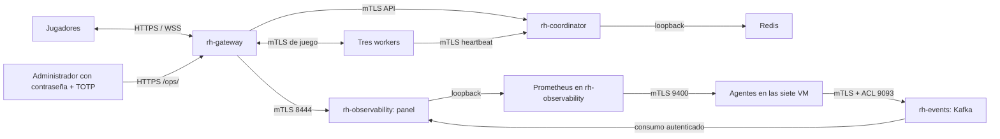

# Observabilidad de Red Horizon — estado verificable

**Implementada y probada localmente; presupuesto aprobado; despliegue AWS pendiente de ampliación de cuota.** Fecha: 17/11/2026. No hay una URL administrativa pública activa. La ruta prevista es `https://redhorizon.lat/ops/`, únicamente después de desplegar y comprobar el acceso.

Se conservaron las cinco EC2, el servicio actual, los datos, DNS y las instancias `redhorizon_last` y `superkanes`. La comprobación HTTPS pública de `/health` respondió `ok: true` con la versión existente `e1fb054af8a3a06f379a3d931ce18630f8e43583`. El código nuevo no está activo en producción.

## Componentes preparados

| VM | Función existente o nueva | Observabilidad preparada |
|---|---|---|
| rh-gateway | Nginx HTTPS/WSS y router Node | Bytes/mensajes lógicos por worker, transporte del proxy, RTT ping/pong, conexiones/rechazos, eventos y logs HTTP sin URL/IP/tokens. Proxy mTLS para `/ops/`. |
| rh-game-01 | Principal i-0db322d7e36dea80a, m7i-flex.large | Salas/jugadores, simulación, event loop, capacidad/drenaje, creación/cierre/reconexión y agente. |
| rh-game-02 | i-0ee8a3a9d7cf9a1f6, t3.small | Misma instrumentación, conservando capacidad medida. |
| rh-game-03 | i-0173a548389b00fb6, t3.small | Misma instrumentación, conservando capacidad medida. |
| rh-coordinator | i-06bb1fd55f4634ed3, t3.micro; Redis loopback | Solicitudes API, eventos y métricas del host. No se exportan códigos ni tokens. |
| rh-observability | **Nueva, no creada**; c7i-flex.large / 30 GiB | Prometheus, panel Node, SQLite de eventos, consumidor Kafka y consultas básicas CloudWatch. |
| rh-events | **Nueva, no creada**; c7i-flex.large / 40 GiB | Un broker/controlador Kafka KRaft con mTLS, ACL, cuotas y retención limitada. |

Gateway existente: `i-050759a4168f12f3b`, t3.micro. Inventario previo: [INVENTORY](../cluster/INVENTORY.md); el inventario operativo utilizado se conserva en `.cluster-local/inventory.json`. La ampliación genera su propio inventario sin reemplazar el de cinco nodos.

Los contadores de host se leen cada cinco segundos; Prometheus scrapea cada cinco segundos y el navegador consulta cada cinco segundos. Son intervalos independientes: la antigüedad visible puede superar cinco segundos. Los eventos se vacían por lotes y pueden llegar después. CloudWatch se consulta cada cinco minutos, conservando timestamp y período reales.

## Panel y seguridad

Vista general, topología, detalle por VM, comparaciones históricas de 5 min/1 h/24 h, actividad, tráfico, percentiles RTT, seguridad y estado de Kafka. Se muestran unidades y ausencia/antigüedad de datos. No hay controles para detener servidores o expulsar jugadores.

Prometheus cubre series temporales. Se eligió panel propio para integrar topología y eventos con una sola autenticación, evitando otro servicio Grafana en esta escala. Kafka transporta eventos operativos, no snapshots ni cada input; las series no se duplican en Kafka.

No se encontró un user pool Cognito en la cuenta. Se preparó autenticación local de servidor con **scrypt + TOTP obligatorio**, sesiones aleatorias de 30 minutos, cookies Secure/HttpOnly/SameSite, protección por origen y límites de intentos. Roles `reader` y `admin`; solo admin consulta detalle de seguridad. No se creó un proveedor OIDC de pago. Si se integra un proveedor corporativo después, sustituir el acceso local con una migración validada.

Exporters y panel privado exigen mTLS con identidad permitida. Kafka exige certificado y ACL por productor/topic/grupo. Prometheus y métricas del panel escuchan en loopback. Security Groups separados para las dos VM nuevas; no se añade SSH público. La PKI de observabilidad es independiente de la del juego.

No se registra contenido de partidas, IP individual, contraseñas, tokens ni códigos utilizables de sala. Los eventos usan UUID internos. Etiquetas de métricas acotadas; cada proceso admite hasta 512 series propias, con versión desplegada constante por proceso. Los logs nuevos de Nginx solo incluyen tiempo, estado, bytes, duración, resultado del límite y categoría fija de ruta.

## Código, configuración y operación

- `server/observability/`: agentes, métricas, colas, Kafka, almacenamiento, autenticación, panel y CloudWatch.
- `web/observability/`: interfaz administrativa separada del bundle público del juego.
- `server/cluster/` y backend: instrumentación opcional; se activa expresamente con `config.observability`.
- `deploy/observability/`: CloudFormation, límite de permisos IAM, política de provisión temporal, unidades systemd y Nginx.
- `scripts/observability/`: laboratorio, pruebas, configuración, empaquetado, provisión protegida por presupuesto explícito, inventario y despliegue adicional por SSM.

La plantilla fue validada por CloudFormation. Prometheus y la configuración Nginx resultante de la configuración real también pasaron sus verificadores. Los scripts de provisión y despliegue **no se han ejecutado contra AWS** y aún requieren la validación de permisos/arranque en las nuevas EC2.

Se mantienen commits y push a `main` con la identidad Git configurada del propietario. GitHub Actions está bloqueado por la facturación de GitHub; las comprobaciones comunicadas se ejecutaron localmente, no se presentan como CI remoto aprobado.

## Pendientes que impiden declarar la plataforma lista

1. **Completado:** [presupuesto incremental](COSTOS.md) de USD 141/mes antes de impuestos aprobado por el propietario.
2. **Pendiente de AWS:** aumento a 20 vCPU solicitado; 16 actuales frente a 18 necesarios. Solicitud `3db4bb40b4b34066ab3a12e43e592d89aH5yqWXl`. No se detuvieron instancias ajenas.
3. Límite IAM `RedHorizonObservabilityRuntimeBoundary` creado. La política temporal de provisión se aplica únicamente durante la ejecución autorizada; no se copian credenciales root a máquinas ni código.
4. Crear las dos EC2, reconciliar IP/IDs, generar las nuevas PEM y la PKI de observabilidad en el directorio autorizado. **Todavía no existen PEM de recuperación para estas dos EC2.**
5. Desplegar agentes, Kafka, Prometheus y panel; comprobar puertos, certificados y roles desde la red real.
6. Drenar y actualizar secuencialmente workers; actualizar entrada/coordinador solo sin conexiones activas. Preservar frontend y sus correcciones de texturas/animaciones.
7. Inscribir el TOTP del propietario y verificar navegador → gateway → panel → métricas/eventos en AWS.
8. Medir 24–72 horas de CPU, memoria, créditos, almacenamiento y latencia; verificar rollback y recuperación sin usuarios activos.

Sin alta disponibilidad: gateway, coordinador, panel/almacenamiento y broker único son puntos de fallo. No se recuperan partidas en memoria al perder su worker. Véanse [catálogo](CATALOGO.md), [pruebas](PRUEBAS.md) y [operación](RUNBOOK.md).

## Vista de flujo y continuación

Se añadió un mapa SVG de las siete VM y sus rutas: WSS, asignación al coordinador, agentes → Kafka → panel y acceso administrativo. Las flechas usan tráfico medido; con muestras ausentes/atrasadas no se simula movimiento. El navegador verificó siete VM y ausencia de errores. No se repitió la batería completa: solo lint de los archivos modificados y esta comprobación visual funcional.

La solicitud de cuota se conserva en `.cluster-local/observability/quota-request.json`. Al aprobarla AWS, continuar la provisión y el RUNBOOK con el presupuesto ya aprobado; no pedir nuevamente autorización económica. No cambiar el plan de cuenta ni detener instancias para eludir la cuota.
