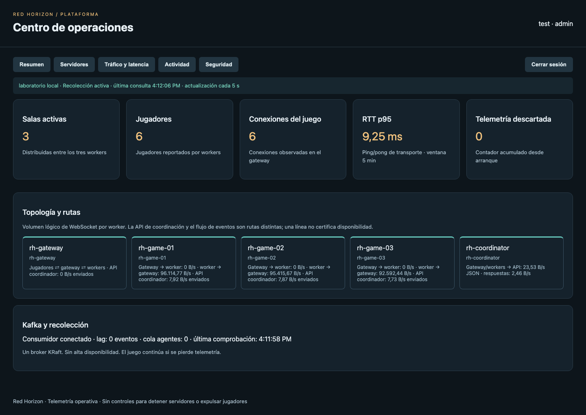

# Resultados reales de validación

Fecha: **17/11/2026**. Entorno aislado en la estación de trabajo, con Kafka y Prometheus reales y Node **22.23.5**, la versión prevista en EC2. **No son pruebas de la ampliación desplegada en AWS.**

## Resultado funcional

| Comprobación | Resultado |
|---|---|
| Suite completa, ESLint y compilación | **208 pruebas aprobadas**, 42 archivos; build correcto. |
| Tres workers, dos clientes por partida | **3 salas / 6 jugadores / 6 conexiones** observados por Prometheus y el panel. |
| Flujo evento → socket del agente → Kafka → SQLite → panel | Aprobado con creación real de salas. |
| RTT de WebSocket | Histograma real con muestras válidas, sin sustituir ausencia por cero. |
| Navegador administrativo | Login con contraseña/TOTP; resumen, servidores, tráfico/gráfico, actividad y seguridad comprobados con Chromium. Sin errores JavaScript. |
| Autenticación y autorización | Sin sesión 401; origen incorrecto 403; reader sin detalle admin; operaciones mutables rechazadas; OTP reutilizado rechazado; sesiones expiran y se revocan. |
| TLS de exporters/panel | Certificado autorizado aceptado; identidad válida pero ajena rechazada; exporter sin certificado rechazado. Validación de cadena/hostname habilitada. |
| ACL Kafka | Productor no puede escribir como otro servidor ni describir/leer topic ajeno; consumidor tiene grupo específico. |
| Duplicados e inválidos | Duplicado contado sin segunda inserción; JSON inválido contado y omitido. |
| Kafka indisponible | Broker aislado pausado durante aproximadamente 12 s; continúan snapshots y respuestas del juego. |
| Recuperación Kafka | Evento nuevo vuelve a producirse, consumirse y aparecer tras reanudar el broker. |
| Colector desconectado/recreado | Se cuentan descartes; el flujo vuelve sin reiniciar el juego. |
| Cuotas Kafka | Ocho identidades configuradas/verificadas con la CLI real. |
| Broker con configuración endurecida | Usuario no root, imagen de solo lectura, capabilities retiradas, controlador TLS en loopback y reinicio conservando metadata: aprobado. |
| IaC | CloudFormation `ValidateTemplate` correcto; pruebas impiden entrada pública, servicios de pago no previstos y gestión de las instancias existentes. |
| Prometheus y Nginx | `promtool check config` y `nginx -t` aprobados; Nginx se verificó sobre una copia de su configuración real. No se recargó producción. |
| Dependencias runtime | `npm audit --omit=dev`: **0 vulnerabilidades informadas** en el momento de la consulta. No equivale a ausencia garantizada de CVE. |

La prueba del broker detectó y corrigió problemas del harness; la prueba con Node 22 detectó el timeout de fetch mayor que el de solicitud y un estado optimista del consumidor. La entrega usa `maxWaitTimeInMs=500` frente a requestTimeout=2000 y marca consumo activo mediante ingreso real al grupo. No se ocultan los fallos iniciales presentando únicamente un arranque como recuperación.

## Comparación de impacto local

Cuatro ejecuciones alternadas, tres workers/seis clientes, unos seis segundos medidos por ejecución, misma estación/proceso; comparación de telemetría desactivada contra telemetría activada con colector deliberadamente ausente. RTT de aplicación medido con llegada de `pong`, sin polling de 20 ms.

| Ejecución | Telemetría | CPU del proceso % | RTT p95 ms | Event loop p99 ms | Simulación máx. ms |
|---|---|---:|---:|---:|---:|
| 1 | No | 15,94 | 1,379 | 22,020 | 3,984 |
| 2 | Sí, colector caído | 15,92 | 1,974 | 22,856 | 1,668 |
| 3 | No | 14,27 | 1,236 | 21,692 | 1,687 |
| 4 | Sí, colector caído | 13,46 | 2,650 | 22,594 | 8,130 |

La simulación siguió y se contaron 15 eventos descartados en cada ejecución con colector ausente. Hay variación y aumento de RTT p95 de aproximadamente 0,6–1,4 ms frente a la ejecución previa. **La muestra es corta y no demuestra ausencia de impacto significativo en producción.** El pico de simulación de una ejecución exige medir ventanas mayores en EC2 antes de sacar conclusiones. Tampoco acredita capacidad máxima por instancia.

En otra prueba integrada, el RTT durante caída de Kafka usa polling de 20 ms; sus valores cercanos a 20 ms **no** se comparan directamente con esta tabla.

Memoria Docker observada en pruebas cortas: Kafka aproximadamente 0,4 GiB; Prometheus aproximadamente 0,04–0,13 GiB. No incluye siete días de retención ni carga máxima; no se usa para prometer que una micro basta.

## Evidencia AWS de solo lectura

El SDK consultó CloudWatch con `rh-cluster-operator`, sin errores, para las cinco máquinas existentes. Una muestra de 300 segundos devolvió:

| VM | CPU promedio % | CPUCreditBalance |
|---|---:|---:|
| rh-game-01 | 1,872 | No aplica |
| rh-gateway | 0,153 | 245,702 |
| rh-game-02 | 1,663 | 466,772 |
| rh-game-03 | 1,411 | 470,924 |
| rh-coordinator | 0,383 | 243,845 |

Es actividad real del clúster previo en esa ventana, no consumo causado por la plataforma nueva ni costo facturado. Timestamp y métricas completas: `.cluster-local/observability/cloudwatch-sample.json`.

El endpoint público HTTPS `/health` respondió `ok: true` con el backend existente. Ninguna prueba de caída/carga se ejecutó contra usuarios o EC2 de producción. No se cambiaron instancias, SG, DNS, roles ni servicios AWS durante esta etapa.

## Evidencias y reproducción

- `verification.json`, `verify-node22.log`: flujo integrado; última ejecución aprobada incluye `measuredWebSocketRTT`, `kafkaRecovery` y `collectorRecovery`.
- `benchmark.json`: ejecuciones alternadas y métricas completas.
- `broker-smoke/result.json`: aislamiento y reinicio persistente del broker.
- `quotas-verification.json`: cuotas aplicadas a ocho identidades locales.
- `check-node22.log`, `audit.json`, `nginx-validation.log`, `promtool.log`, `template-validation.json`.
- Todos bajo `.cluster-local/observability/`, fuera de Git. Los comandos reproducibles están en [RUNBOOK](RUNBOOK.md).

La captura identifica **laboratorio local**. No contiene credenciales ni representa máquinas nuevas desplegadas.

## Validaciones aún pendientes

- Arranque y permisos efectivos de IAM/SSM en las dos EC2 propuestas, puertos desde Internet/VPC y conexión privada completa.
- URL pública `/ops/`, credenciales reales inscritas, TLS extremo a extremo vía Nginx y roles del propietario.
- Activación por drenaje del backend, despliegue secuencial y rollback sobre las nuevas máquinas; la sintaxis/configuración local no demuestra ese procedimiento remoto.
- Comparación de latencia/CPU/memoria antes/después con carga representativa, retención de 24–72 h y alertas operativas atendidas por una persona.
- Recuperación de pérdida completa de disco: no hay réplica ni backup externo automático.
- GitHub Actions: bloqueado por facturación de GitHub, sin ejecutar jobs. La evidencia publicada corresponde a ejecución local, no a CI remoto verde.

Estas limitaciones impiden declarar listo el despliegue AWS. La siguiente acción facturable requiere aprobar [COSTOS](COSTOS.md).
